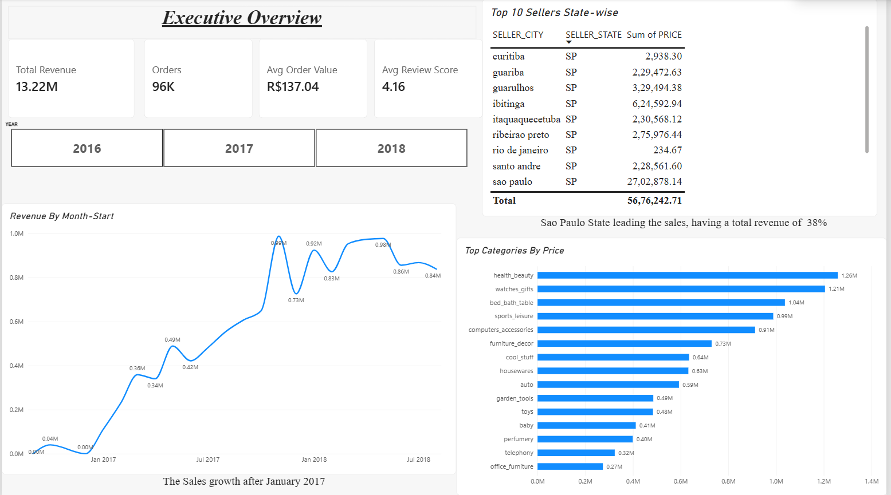
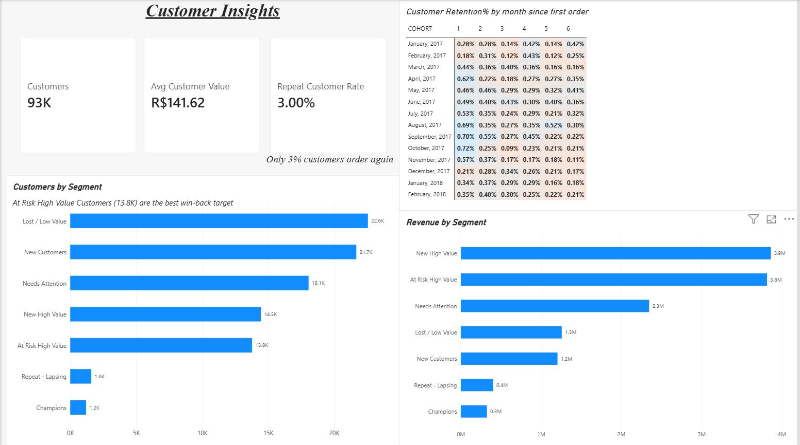

# Ecommerce Sales & Customer Retention Analytics
An end-to-end analysis about 100K+ orders from a Brazilian Online Marketing dataset(Olist 2016 - 2018). I modeled the raw data into Snowflake with SQL and built a 3-page dashboard in Power BI answering revenue, customer retention, delivery performance.

 Tools Used: Snowflake, SQL, Power BI(DAX)

 Dataset: 9 tables including customers, orders, payments, review score, items, product & sellers details.

 Approach: I'm going to answer a few Business Questions from my analysis showcasing charts and sql snippets.

         1. How the revenue is growing and which categories and region helps drive it?
         
         2. Do customers come back after their first order?
         
         3. Which customers are worth the most and who is at worth a shot for winning back?
         
         4. Do late deliveries hurt customer satisfaction?
         

Building one row per order without inflating revenue

Orders can have several items and payments. Joining the tables directly would multiply rows and overcount revenue, so each table is first aggregated to one row per order.

                                                          **Executive Overview**

What it Shows: Monthly Revenue, Top Product Categories, Revenue by State
1. In the line chart Revenue by Month the revenue only grows after January 2017 peaking through about 1M by late November 2017 and held between 0.8M to 0.9M
   in 2018 through August.
2. In Column Chart top categories growth sales such as Health-beauty, Watches-gifts, bed-bath table, sports leisure being the top through all three years:
   
   In 2016 Health Beauty 450K sales, Watches-gifts 3.4k, sports leisure 3.3k
   
   In 2017 Health Beauty 0.48M sales, Watches-gifts 0.50M, sports leisure 0.45M, Bed_bath_table 0.55M
   
   In 2018 Health Beauty 0.77M sales, Watches-gifts 0.71M, sports leisure 0.53M, Bed_bath_table 0.54M
   
3. In Table view Sao Paulo being the top leading state in revenue with a total of 38% revenue.
 
4. The Avg Review Score includes DAX measure of review_score column, Avg Order value includes division between revenue and orders.

                                                    **Customer Insights**

1. In table view Monthly Retention is very low between 0.1% to 0.7% of each cohort in the months after their first order
2. Champions and Repeat customers are about 2.8K ( about 3K of the base) so the currently the business depends on constantly acquiring new buyers.
3. About 13.8k At Risk High Value (single high spend buyers who haven't returned back) are the clearest win-back target. They amount about 3.8M in revenue.
4. Revenue by segment shows New High Value 3.9M revenue where customers are 14.5k, At Risk High Value amount 3.8M where customers are 13.8k, where Champions and      Repeat customers amount about 0.3M and 0.4M respectively where customers are 1.2k and 1.6k at low value since repeat buyers are rare. Lost/Low Value amount        about 1.3M where customers are high value 22.6k because each customer spends little.

